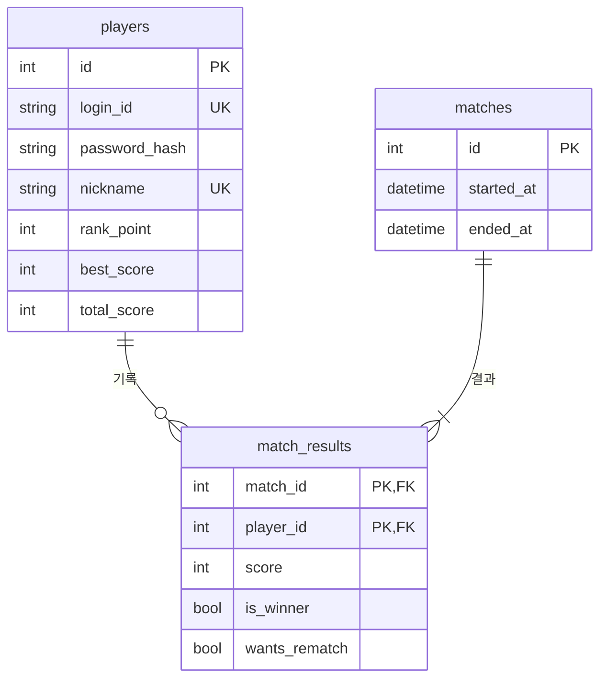
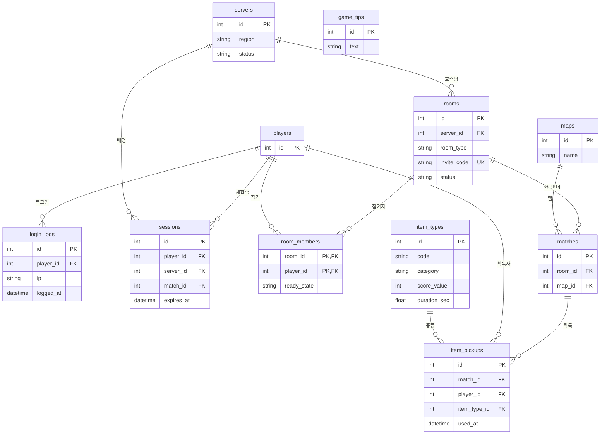

# 배틀 아레나 DB 설계 (ERD)

> 실시간 대전 캐주얼 · 한 판 2명 · 100초 · 아이템을 가장 많이 지닌 쪽이 승리 · WASD/방향키 8방향 이동

- **핵심 3개**: `players`, `matches`, `match_results` — 판이 끝나면 한 트랜잭션으로 저장
- **확장 9개**: 접속 · 방 · 아이템 · 기획 데이터
- 캐릭터 위치, 타이머, 키 입력처럼 실시간으로 바뀌는 값은 DB가 아니라 서버 메모리와 패킷으로 처리

---

## 1. 핵심 테이블

판 종료 시 처리 순서 (한 트랜잭션):

1. `matches`에 판 생성 (`started_at`, `ended_at`)
2. `match_results`에 두 플레이어의 점수, 승패, 한 판 더 여부 저장
3. `players`의 `best_score`, `total_score`, `rank_point` 갱신

---

## 2. 확장 테이블

핵심 테이블은 `id`만 표시해서 연결 위치만 보이게 했습니다.

| 묶음 | 테이블 | 담당 기능 | 관련 패킷 |
|---|---|---|---|
| 접속 | `login_logs`, `sessions`, `servers` | 로그인 기록, 재접속 시 원래 서버로 복귀, 서버 상태 | Type 1, 3, 재접속 |
| 방 | `rooms`, `room_members` | 퀵/사설매치, 초대코드, 준비 상태, 한 판 더 | Type 2, 3, 4 |
| 아이템 | `item_pickups`, `item_types` | 코인 점수, 1회성 아이템 사용 여부 | Type 6 |
| 기획 데이터 | `maps`, `game_tips` | 맵, 로딩 화면 팁 | Type 5, 6 |

---

## 3. 설계 메모

- **1회성 아이템 규칙** (쓰면 점수 X, 안 쓰면 점수 O): `item_pickups.used_at`이 비어 있으면 점수에 포함, 값이 있으면 제외
- **한 판 더**: 두 플레이어의 `wants_rematch`가 모두 true면 같은 `room`에 새 `match` 생성 → `rooms : matches = 1 : N`
- **재접속**: 게임 안에서 나갔으면 `sessions`의 `server_id`, `match_id`로 원래 화면에 복귀 / `expires_at`이 지나면 다시 로그인
- **복합키 테이블**: `match_results`, `room_members`는 N:M 관계를 1:N 두 개로 푸는 연결 테이블
